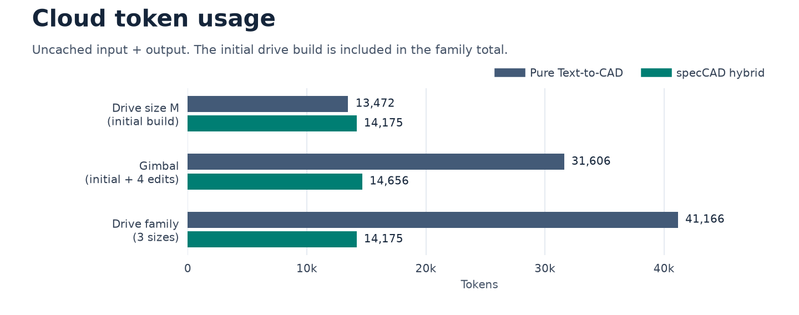
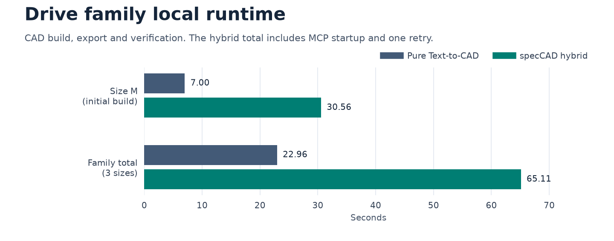

# specCAD

**Local-first CAD automation for repeatable mechanical assemblies.**

specCAD turns YAML or JSON manifests into CadQuery solids, checks volume and interference with OpenCASCADE, and exports STEP and GLB. Define a part family once, then place its instances in a line, on a bolt circle, or with individual transforms.

- **Deterministic compiler** for shafts, flanges, sleeves, brackets, hollow frustums, and swept tubes.
- **MCP server** for batch compilation, assembly, and file inspection.
- **Local planning** with Ollama, plus optional direct cloud planning with a bounded repair pass.
- **Verification** for watertight solids, expected volumes and bounds, and BRep interference. Reports distinguish confirmed clearance from incomplete checks.

## Quick start

Use Python 3.12. Run these commands from the repository root in PowerShell.

```powershell
python -m venv .venv
.\.venv\Scripts\python.exe -m pip install -r requirements.txt
.\.venv\Scripts\python.exe -m orchestrator.hybrid_orchestrator examples/drive_family/size_m.json --output workspace/drive_m
```

The example creates a 40-solid drive unit with STEP, GLB, and a verification report. Each invocation needs a new output directory.

For a local natural-language plan, start Ollama and use `--local-only` with `--prompt`. The default model is `qwen2.5:1.5b`. The manifest example can run without Ollama or a cloud key.

```powershell
ollama pull qwen2.5:1.5b
.\.venv\Scripts\python.exe -m orchestrator.hybrid_orchestrator --local-only --prompt "A 10 mm diameter pin, 16 mm tall, at the origin." --export-name pin --output workspace/pin
```

## Use as an MCP server

Configure your MCP client to launch the virtual environment's Python with `-m mcp_server.server` and set its working directory to the repository root. See the [Codex guide](CODEX.md) for manifest syntax and optional cloud configuration.

## Benchmark

These A/B runs compare **pure Text-to-CAD with Codex Sol 6.2 (`gpt-6.2-sol`)** against **specCAD's manifest-based hybrid workflow**. The direct route starts with generated CadQuery code and uses a Codex call for each revision or size variant. The hybrid route uses Codex for the initial plan and applies subsequent changes locally. Both routes had to pass geometry and interference checks.



| Workload | Pure Text-to-CAD tokens | specCAD tokens | Hybrid change | Cloud calls (direct → hybrid) |
| --- | ---: | ---: | ---: | ---: |
| Drive size M only (40 solids) | 13,472 | 14,175 | 5.22% more | 1 → 1 |
| Gimbal initial build + four revisions (35 solids) | 31,606 | 14,656 | 53.63% fewer | 5 → 1 |
| Drive family M/L/S (40, 56, 32 solids) | 41,166 | 14,175 | 65.57% fewer | 3 → 1 |

The token metric adds uncached input and output, including any reported reasoning in output. The drive family total includes size M. Both routes qualified all five gimbal rounds and all three drive sizes.

**Strength.** Once the design was in a manifest, the four gimbal revisions used **0 additional cloud tokens** versus **17,440** for the direct route. The two derivative drive sizes also used **0 additional cloud tokens**. A placement correction identified by collision checks on the first hybrid gimbal build was applied locally before qualification.



**Weakness.** The first drive build used more cloud tokens and took longer locally. Across all three sizes, the hybrid route took **65.11 s** locally versus **22.96 s** for the direct route. That timing covers build, export and independent verification, including MCP startup and one local assembly retry on the hybrid side. Cloud generation time is outside this measurement.

The workloads favor changes that fit the manifest. Changes requiring new freeform geometry may need more cloud calls. These runs measure manifest edits and provide no measurement of Ollama-generated revisions. [Drive family methodology and recorded results](benchmarks/drive_family_ab/report.md)

## Tests

```powershell
.\.venv\Scripts\python.exe -m pytest -q
```

The optional live-model test requires Ollama and `CAD_RUN_OLLAMA_TESTS=1`.
